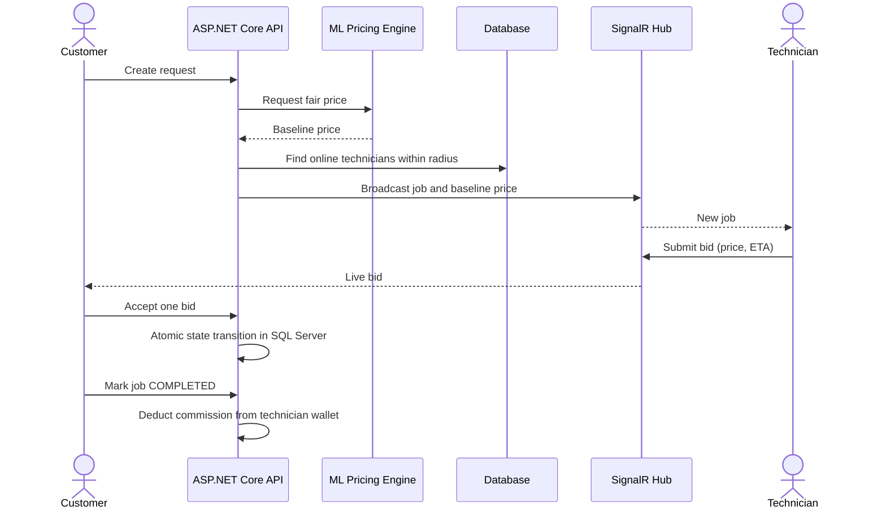
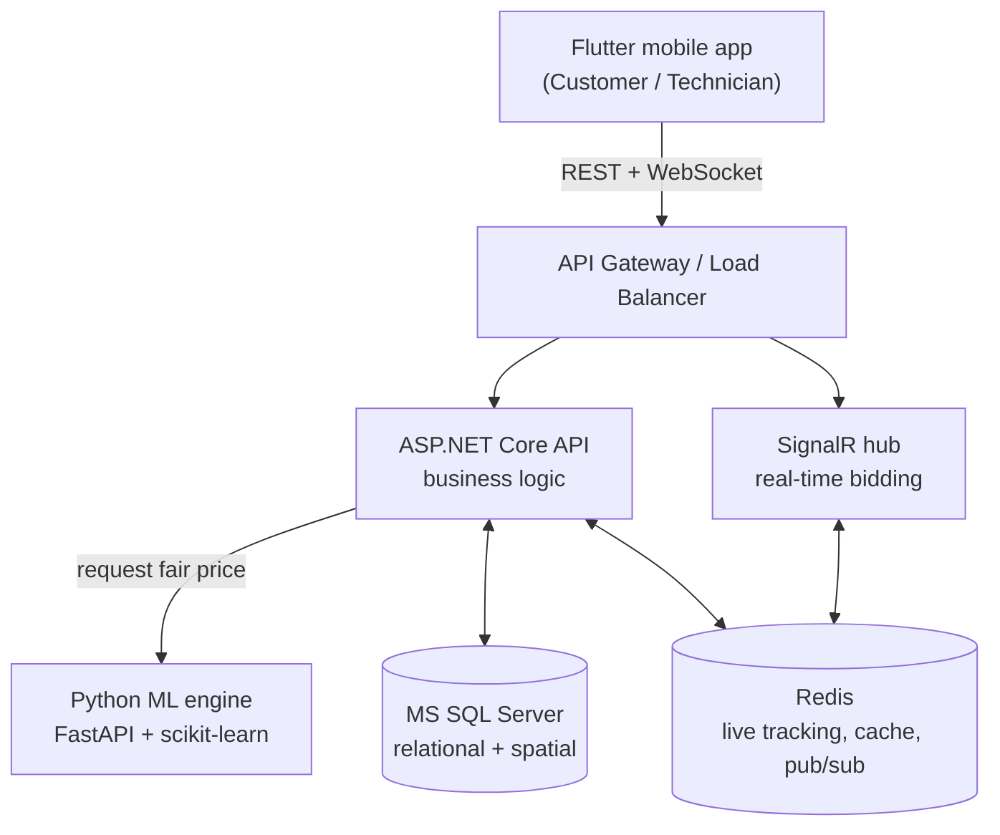

# Sany3y (صنايعي)

> A real-time bidding marketplace that connects customers with nearby technicians and blue collar workers (plumbing, electrical, carpentry and more), with an AI-generated fair baseline price.


[](https://github.com/<your-org>/sany3y/actions/workflows/backend-ci.yml)
[](https://github.com/<your-org>/sany3y/actions/workflows/ml-service-ci.yml)
[](https://github.com/<your-org>/sany3y/actions/workflows/mobile-ci.yml)

Graduation project, Faculty of Computer and Information Sciences, Ain Shams University (FCIS ASU), Information Systems, 2026–2027.

## Contents

[Overview](#overview) · [How it works](#how-it-works) · [Features](#features) · [Architecture](#architecture) · [Tech stack](#tech-stack) · [Repository structure](#repository-structure) · [Documentation](#documentation) · [Team](#team) · [Contributing](#contributing)

## Overview

Finding a reliable technician usually means phone calls, word of mouth and prices nobody can check. Sany3y replaces that with a live marketplace:

- A **customer** posts a job with a service category and GPS location.
- An **AI pricing engine** suggests a fair baseline price.
- Only **online technicians within a set radius** get the job.
- Technicians **bid** with a price and an ETA, and the customer sees bids arrive live.
- The customer accepts **exactly one** bid, and the system guarantees no technician is ever double-booked.

## How it works



## Features

### MVP (SRS section 1)

| Area | What the system does
|---|---|
| Accounts | Register and log in with email or phone number; stateless JWT for the REST API |
| Requests | Customer picks a service category and the app captures exact GPS coordinates |
| Availability | Technicians must be set to **Online** to receive job broadcasts |
| AI pricing | FastAPI + Random Forest returns a baseline price in EGP in under 500 ms; static fallback price if the service is down |
| Dispatch | Redis tracks active technicians; jobs go only to technicians inside the radius |
| Bidding | Technicians bid with price and ETA; bids reach the customer over SignalR in under 200 ms; the window closes after a set time (e.g. 5 min) or when a bid is accepted |
| Atomic booking | One accepted bid per request; an atomic database transition prevents double-booking |
| Job closure | The customer marks the job COMPLETED, which is the only trigger that closes the workflow |
| Commission | Simulated technician wallet; commission on the accepted bid is deducted on completion (balances seeded manually for the MVP) |

### Phase 2 (documented, out of MVP scope)

Live payment gateway (Fawry / Paymob) · admin verification and dispute resolution · automated cancellation penalties · bid rate-limiting · push notifications (FCM) · offline queuing on the mobile client.

## Architecture





## Tech stack

| Layer | Technology |
|---|---|
| Mobile | Flutter (Android and iOS from one codebase) |
| Backend API | ASP.NET Core Web API (.NET 10 LTS), SignalR, Entity Framework Core |
| Database | Microsoft SQL Server (relational + `geography` spatial types) |
| Live state | Redis |
| AI pricing | Python, FastAPI, scikit-learn (Random Forest Regressor) |
| Infrastructure | Docker, Docker Compose, GitHub Actions; target cloud AWS or Azure |

## Repository structure

```
sany3y/
├── backend/                 ASP.NET Core (Clean Architecture, modular monolith)
│   ├── src/
│   │   ├── Sany3y.Domain/           entities, enums, business rules
│   │   ├── Sany3y.Application/      use cases by feature (Auth, ServiceRequests, Pricing,
│   │   │                            Dispatch, Bidding, Jobs, Payments, Reputation)
│   │   ├── Sany3y.Infrastructure/   EF Core, Redis, ML client, JWT
│   │   └── Sany3y.Api/              controllers, SignalR hubs, Program.cs
│   └── tests/                       unit and integration tests
├── ml-service/              Python FastAPI service + model training pipeline
├── mobile/                  Flutter app (feature-first folders)
├── infra/                   SQL seed scripts, nginx gateway config, helper scripts
├── docs/                    SRS, user stories, diagrams, ERD, ADRs
├── .github/                 CI workflows, PR and issue templates
├── docker-compose.yml       SQL Server + Redis for local development
└── .env.example             configuration template
```


## Team

| Name | Role |
|---|---|
| _Abdelrahman Ahmed_ | _e.g. Backend_ |
| _Mostafa Mahmoud Abo Hagag_ | _e.g. Mobile_ |
| _Abdullah Amr_ | _e.g. ML / AI_ |
| _Khaled Mubarak_ | _e.g. ML / AI_ |
| _Momen Mouhammed_ | _e.g. Backend_ |
| _Mostafa Mahmoud Hosin_ | _e.g. Backend_ |

Supervisor: _Dr. Fatma Mohammed_

## Contributing

- Leaving it empty for now.

## License

To be decided. This is an academic project; add a `LICENSE` file before making the repository public.
